# StarkTech Media Player

Player e biblioteca de mídia para **Android TV e tablet**, gratuito e em português. Lê o HD ou o armazenamento do aparelho, organiza filmes, séries, desenhos, shows e stand-up com capa, sinopse, capítulos e dados técnicos, e toca MKV e MP4 até 4K.

Sem login e sem conta: a biblioteca fica no aparelho. O mesmo APK roda na TV, no tablet e no celular.

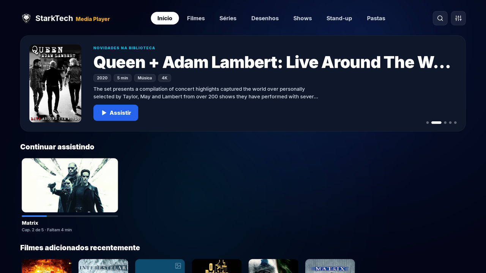

| | |
|---|---|
| **Versão** | 1.0.0 |
| **Pacote** | `br.com.starktechstudio.mediaplayer` |
| **Android** | 6.0 ou mais novo |
| **Tamanho do APK** | cerca de 110 MB (um APK só, para qualquer processador) |
| **Idioma** | português do Brasil |
| **Desenvolvedor** | StarkTech Studio |

## Telas

Na TV. Prints feitos no emulador, com vídeos de teste gerados só para isso (por isso o player mostra um padrão colorido). Capas, fundos e sinopses vêm do TMDB.

| Filmes, com selos e filtro | Detalhe, com capítulos |
|---|---|
| 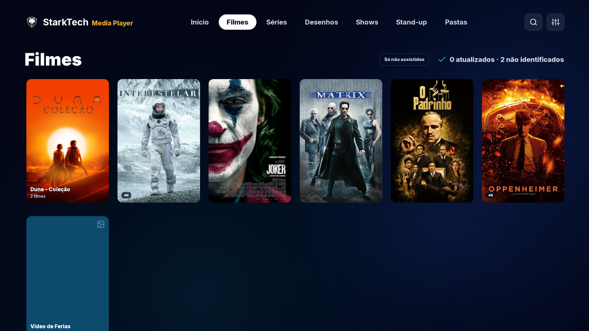 | 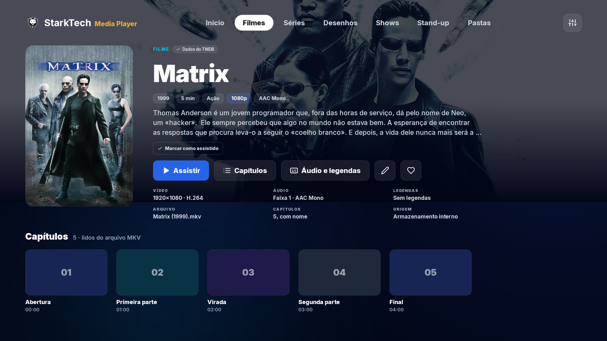 |

| Player | Legenda em arquivo |
|---|---|
| 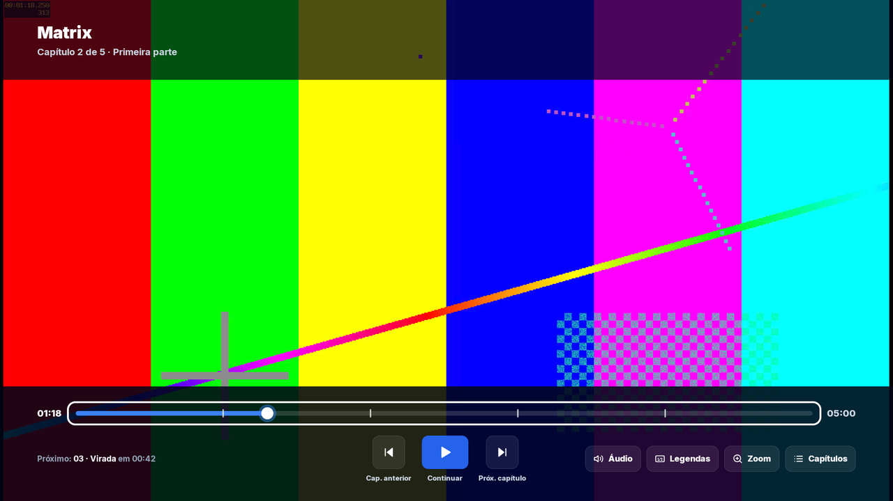 | 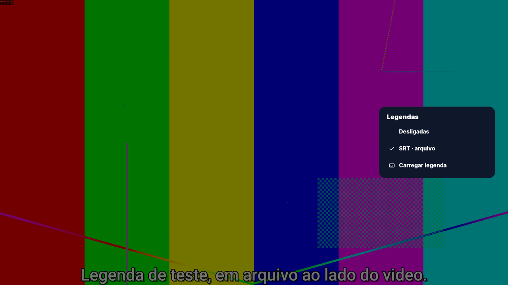 |

| Séries | Shows, por artista |
|---|---|
| 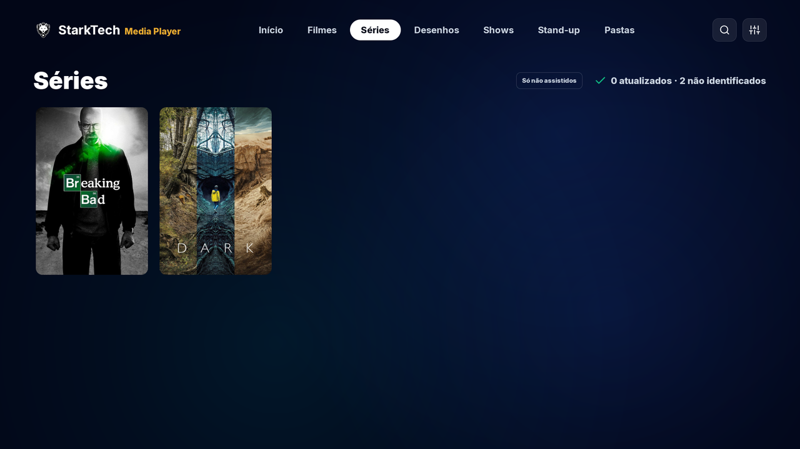 | 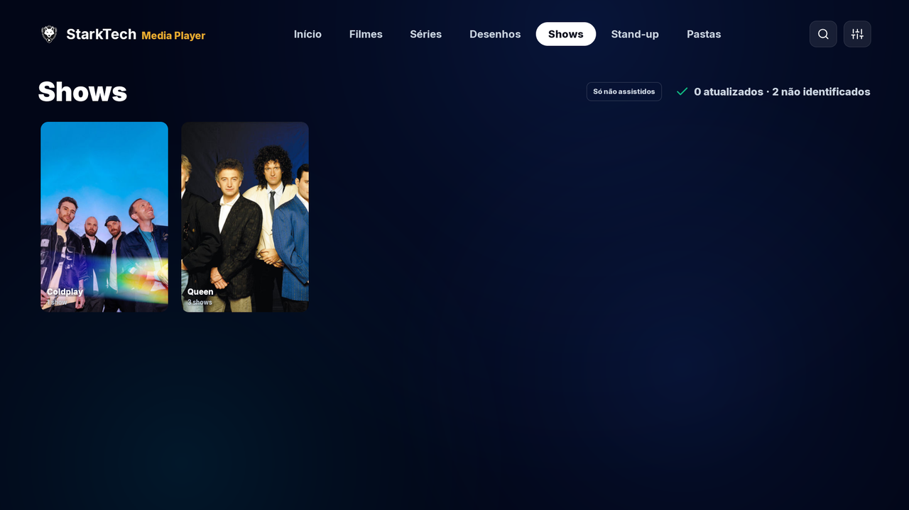 |

| Página do artista | Escolher outra foto |
|---|---|
| 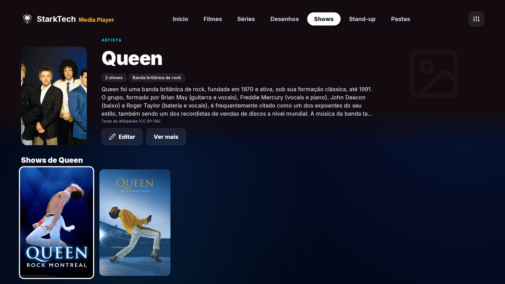 | 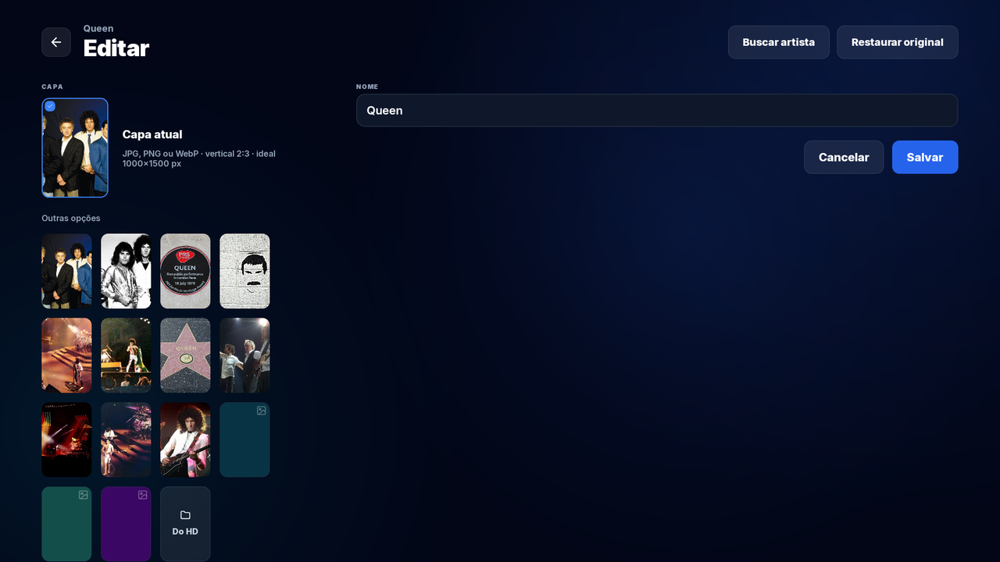 |

| Buscar artista e juntar pastas | Pastas da biblioteca |
|---|---|
| 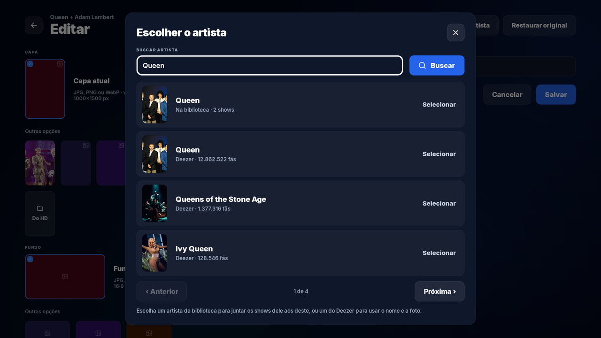 | 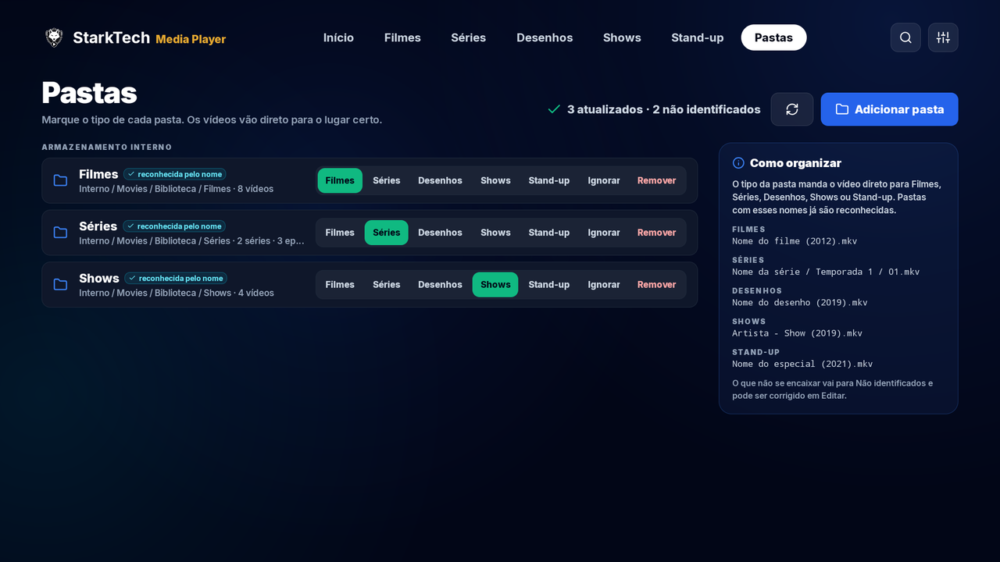 |

| Configurações: versão e atualização |
|---|
| 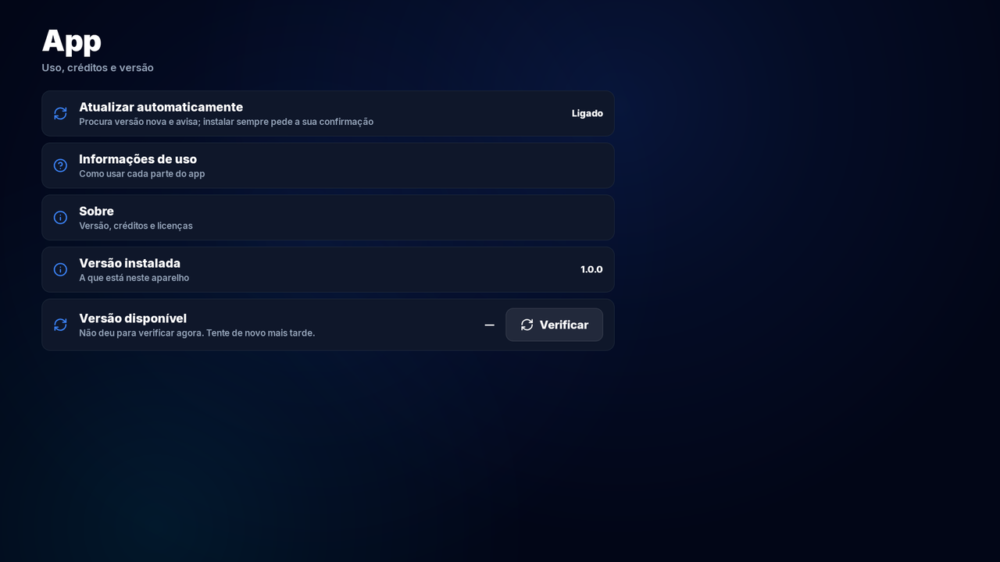 |

## O que o app faz

### Biblioteca

- **Por pastas:** você marca o tipo de cada pasta (Filmes, Séries, Desenhos, Shows, Stand-up) e os vídeos vão para o lugar certo. Pasta com esses nomes é reconhecida sozinha.
- **Dados do TMDB:** capa, fundo, sinopse, ano, gêneros, elenco e coletâneas ("Dune - Coleção" reúne os filmes dela).
- **Continuar assistindo e Favoritos:** o cartão sem imagem do TMDB usa um quadro do próprio vídeo.
- **Selos na capa:** 4K, HDR e a nota do filme.
- **Só não assistidos:** um botão esconde o que você já viu, em todas as abas.
- **Editar:** corrige título, ano, sinopse, capa e fundo à mão; o que você muda não é sobrescrito. Vídeo que o app não reconhece vai para Não identificados.
- **Persistente:** tirar o HD e colocar de novo não apaga nada.

### Shows

- **Por artista:** cada artista tem capa e página própria, com o texto da Wikipédia e os shows dele em destaque; se quiser, em grupos por subpasta.
- **Trocar a foto:** opções do artista certo, do Deezer e da Wikipédia, ou uma imagem sua.
- **Juntar pastas:** "Queen + Adam Lambert" pode entrar em "Queen" pelo Editar, sem mexer nos arquivos. Restaurar original desfaz.

### Player

- **Motor próprio:** FFmpeg, com H.264, H.265, AV1, VP9 e outros, e áudio direto para o receiver (Dolby e DTS).
- **Capítulos:** lidos do arquivo, com marcas na barra, lista e botões de próximo e anterior.
- **Retomar:** volta de onde parou, em qualquer título.
- **Áudio e legendas:** a escolha fica guardada por título e, em série, vale para os outros episódios.
- **Legenda em arquivo:** `.srt`, `.ass`, `.ssa` e `.vtt`. Com o mesmo nome do vídeo, entra sozinha; "Carregar legenda" escolhe outra na hora.
- **Forma da legenda:** tamanho, fonte, cor, contorno, sombra, fundo e posição.
- **Zoom, taxa de atualização da TV e próximo episódio automático.**
- **Controle da TV:** Voltar recolhe a barra; com ela recolhida, avisa e, na segunda vez, sai do vídeo.

### TV e tablet

- **TV:** tudo no controle remoto, com foco em linha reta, Novidades com prévia em vídeo e busca.
- **Tablet:** barra lateral, toque, tela cheia automática e picture-in-picture.

## Instalar

1. Baixe o APK e abra no aparelho. O Android pede para permitir a instalação fora da loja.
2. Ao abrir o app, permita a leitura dos vídeos e o acesso a todos os arquivos, usado para enxergar as legendas em arquivo.
3. Em **Pastas**, adicione as pastas dos seus vídeos.

Organização sugerida:

```text
Filmes/Nome do filme (2012).mkv
Séries/Nome da série/Temporada 1/01.mkv
Desenhos/Nome do desenho (2019).mkv
Shows/Artista - Show (2019).mkv
Stand-up/Nome do especial (2021).mkv
```

**TV sem a tela do acesso a todos os arquivos** (algumas não têm): sem ele, o app funciona, mas sem legenda em arquivo. Para liberar por um computador, depois de instalar:

```bash
adb shell appops set --uid br.com.starktechstudio.mediaplayer MANAGE_EXTERNAL_STORAGE allow
```

## Atualização

Em **Configurações → App**: Atualizar automaticamente, Versão instalada e Versão disponível, com o aviso de que está na última versão ou de que há uma nova. Com o automático ligado, o app também avisa ao abrir. A atualização mantém os dados, e o Android sempre pede a sua confirmação.

## Para desenvolver

| | |
|---|---|
| **Base** | Fork do [Nova Video Player](https://github.com/nova-video-player/aos-AVP) v6.6.2 |
| **Linguagens** | Java (app) e C (motor) |
| **Ambiente** | WSL2 (Ubuntu), JDK 17, AGP 9.3.3, Gradle 9.5.0, NDK |
| **SDK** | compileSdk 37, targetSdk 36, minSdk 23 |

```text
Video/            App: telas de TV e tablet e a lógica da biblioteca
MediaLib/         Banco de mídia e ponte Java do motor
FileCoreLibrary/  Acesso a arquivos
native/avos/      Motor nativo em C, com FFmpeg
native/prebuilt/  Binários prontos de terceiros
design/icone/     Ícone do app
docs/             Documentação
```

Build, sempre no WSL:

```bash
cd Video
./gradlew -Puniversal assembleNoamazonDebug -x lintNoamazonDebug    # teste
./gradlew -Puniversal assembleNoamazonRelease                       # versão publicada
```

Chaves (TMDB, TheAudioDB e a assinatura do APK) ficam fora do repositório. Detalhes em [`docs/operacional/build.md`](docs/operacional/build.md).

## Documentação

| Arquivo | O que tem |
|---|---|
| [`docs/index.md`](docs/index.md) | Catálogo de tudo |
| [`docs/arquitetura/interface.md`](docs/arquitetura/interface.md) | Telas no código |
| [`docs/arquitetura/motor.md`](docs/arquitetura/motor.md) | Biblioteca, banco e regras |
| [`docs/arquitetura/licencas.md`](docs/arquitetura/licencas.md) | Licença de cada parte |
| [`docs/operacional/build.md`](docs/operacional/build.md) | Ambiente, build, assinatura e versão |
| [`docs/operacional/liberar-ao-publico.md`](docs/operacional/liberar-ao-publico.md) | O que resolver antes de liberar ao público |
| [`docs/backlog.md`](docs/backlog.md) | Pendências |

## Situação

Versão 1.0.0, de uso próprio, em teste. O código é público, e as versões do app ficam nas releases deste repositório.

**Antes de liberar ao público**, há pendências de termos e licenças. A principal: os termos do Deezer limitam o uso a fim privado e familiar, então ele precisa sair do app ou ter autorização. A lista completa, com o que os termos do TMDB, da Wikipédia e das bibliotecas pedem, está em [`liberar-ao-publico.md`](docs/operacional/liberar-ao-publico.md).

## Créditos

- Baseado no [Nova Video Player](https://github.com/nova-video-player/aos-AVP) (Apache-2.0).
- Este produto usa a API do TMDB, mas não é endossado nem certificado pelo [TMDB](https://www.themoviedb.org/).
- Texto dos artistas: [Wikipédia](https://pt.wikipedia.org/) (CC BY-SA). Fotos: [Deezer](https://www.deezer.com/) e [Wikimedia Commons](https://commons.wikimedia.org/), cada uma com a sua licença.
- FFmpeg, dav1d, libass, FreeType, FriBidi, HarfBuzz e as demais bibliotecas: lista e licenças em [`licencas.md`](docs/arquitetura/licencas.md) e na tela Sobre do app.

---

© 2026 StarkTech Studio
